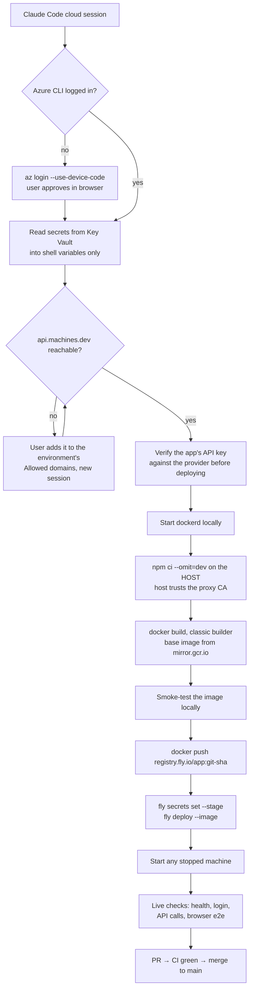

# 🚀 SOP: Deploying to Fly.io from a Claude Code Cloud Session

> **Stage 4 of 7, Formula:** a repeatable procedure for shipping a containerised web app to Fly.io from a sandboxed Claude Code cloud session, with secrets kept in Azure Key Vault.
>
> **Worked example:** [rifaterdemsahin/live-overlay-assistant](https://github.com/rifaterdemsahin/live-overlay-assistant), a Node/Express app on Fly.io. That repo's [`scripts/deploy-cloud.sh`](https://github.com/rifaterdemsahin/live-overlay-assistant/blob/main/scripts/deploy-cloud.sh) automates this whole procedure. It was used for releases v9 to v11.

---

## ✨ Why this needs its own procedure

A Claude Code cloud session runs in an isolated container:
- Outbound traffic goes through a proxy that applies a network allowlist and re-signs TLS.
- There are no cloud credentials.
- Docker is installed but its daemon isn't running.

The usual `fly deploy` path fails in this environment. The first real deploy hit **six technical blockers and two process mistakes**. Each was fixed without weakening security; no TLS verification was disabled and no secret was pasted into the chat.



---

## 🐛 The blockers and how each was solved

| # | Blocker | Symptom | Root cause | Fix |
|---|---|---|---|---|
| 1 | No cloud credentials | `az account show` → "Please run 'az login'" | Fresh container, nothing pre-configured | `az login --use-device-code --allow-no-subscriptions`. The user approves the code at `https://login.microsoft.com/device`, so no password ever reaches the session. |
| 2 | Fly's Machines API blocked | `fly …` → `Get "https://api.machines.dev/…": Forbidden` | The environment's network policy (proxy returns 403) | The user adds `api.machines.dev` under the environment's **Allowed domains**. It needs a settings change; a token can't fix it. |
| 3 | Fly remote builder unusable | `fly deploy --remote-only` → "remote builder app unavailable". Builder logs show `http2 error … frame with invalid size`. The default Depot builder (`depot.dev`) is unreachable. | Remote builders need a WireGuard tunnel, or HTTP/2 to the builder through the sandbox | Don't use remote builders: **build locally** (blockers 4 to 6). |
| 4 | No Docker daemon | `docker info` → "cannot connect" | The daemon isn't started in the container | `dockerd` is installed and the session runs as root: `(dockerd >/tmp/dockerd.log 2>&1 &)` |
| 5 | Docker Hub rate limit | `429 Too Many Requests` on `registry-1.docker.io/…/manifests/22-alpine` | Anonymous pulls from a shared egress IP | Pull the same official image from Google's mirror `mirror.gcr.io/library/node:22-alpine`. Build with `DOCKER_BUILDKIT=0`, because BuildKit also fetches its Dockerfile frontend from Docker Hub. |
| 6 | npm unreachable inside builds | `npm ci` → "Exit handler never called!". In a container, `wget https://registry.npmjs.org` → `tls_post_process_server_certificate` | The proxy re-signs TLS; the host trusts its CA but build containers don't | Run `npm ci --omit=dev` **on the host** and copy `node_modules` into a minimal runtime image. This is safe when dependencies are pure JS. Projects with native modules should build on the target base image instead (CI or a laptop). |

### 🩹 Process mistakes, now guarded against

| # | Mistake | What happened | Guard |
|---|---|---|---|
| 7 | Ambient env var overwrote a secret | The deployer's shell already exported `MIMO_API_KEY` (another provider's key). The deploy script stored it in Key Vault as the app's key, and the live app got 401s. | Scripts never read generic names like `MIMO_API_KEY`. Storing a key needs an explicit `STORE_…` variable. **Every deploy checks the key against the provider's API before touching Fly.** To roll back, restore the previous secret version from the Key Vault history. |
| 8 | Wrong API for Fly secrets | While the Machines API was blocked, the secret was set through Fly's GraphQL `setSecrets`. GraphQL showed it, but the app kept the old value. | Machines-based apps read secrets from the Machines API store. Use `fly secrets set --stage`, then deploy. Use GraphQL only to read app and release state. |

---

## 🛠 Procedure

### 0. One-time environment setup (the user does this)

In the Claude Code environment settings (cloud environment menu → **Edit**):
- **Network access → Allowed domains:** add `api.machines.dev`. Keep "Allow package managers" ticked.
  These were reachable by default and are also needed: `api.fly.io`, `registry.fly.io`, `<app>.fly.dev`, `mirror.gcr.io`, `registry.npmjs.org`, `login.microsoftonline.com`, `management.azure.com`, `*.vault.azure.net`, `api.github.com`, plus your app's upstream APIs.
- **Optional:** add `AZURE_CLIENT_ID`, `AZURE_CLIENT_SECRET` and `AZURE_TENANT_ID` for a service principal with **Key Vault Secrets User** on the vault, to skip the device-code login.

Changes apply to **new** sessions.

### 1. Secrets map (worked example: Key Vault `dp-kv-deliverypilot`)

| Key Vault secret | Becomes | Check |
|---|---|---|
| `FLY-API-TOKEN` | `FLY_API_TOKEN` for flyctl | `fly auth whoami` |
| `live-asistant-xiamimimo` | Fly secret `XIAOMI_MIMO_API_KEY` | `GET https://api.xiaomimimo.com/v1/models` → 200 |
| `live-asistant-basic-auth-password` | Fly secret `BASIC_AUTH_PASS` | login succeeds |

🔐 **Rules:**
- Read secrets into shell variables only. Never echo, log, write to files or commit them. To prove a value, show only its length and prefix.
- Writing to a vault is outward-facing: confirm with the user first.

### 2. Sign in to Azure

```bash
az account show --query user.name -o tsv || az login --use-device-code --allow-no-subscriptions
```

In Claude Code, run the login with `run_in_background: true` (a plain `&` is killed when the tool call returns). Read the code from the task output and ask the user to approve it.

### 3. Build, push, deploy

```bash
export FLY_API_TOKEN="$(az keyvault secret show --vault-name <vault> -n FLY-API-TOKEN --query value -o tsv)"
(dockerd >/tmp/dockerd.log 2>&1 &); sleep 5

TAG=registry.fly.io/<app>:git-$(git rev-parse --short HEAD)-$(date +%s)
B=$(mktemp -d)
npm ci --omit=dev
cp -r package.json server public node_modules "$B/"
cat > "$B/Dockerfile" <<'EOF'
FROM mirror.gcr.io/library/node:22-alpine
ENV NODE_ENV=production PORT=8080
WORKDIR /app
COPY node_modules ./node_modules
COPY package.json ./
COPY server ./server
COPY public ./public
USER node
CMD ["node", "server/index.js"]
EOF
DOCKER_BUILDKIT=0 docker build -t "$TAG" "$B"

# smoke test before shipping
docker run -d --rm --network host --name smoke -e PORT=8199 "$TAG"; sleep 2
curl -s localhost:8199/healthz; docker rm -f smoke

fly auth docker && docker push "$TAG"
fly secrets set --app <app> --stage KEY1="$VALUE1" KEY2="$VALUE2"
fly deploy --app <app> --image "$TAG" --ha=false
fly machine start <machine-id> --app <app>   # if the machine shows "stopped"
```

> ℹ️ `min_machines_running = 1` in `fly.toml` stops Fly from shutting the last machine down. It doesn't start a machine that is already stopped.

### 4. Verify the live site (a deploy isn't done until these pass)

| Check | Expected |
|---|---|
| `GET /healthz` | `{"ok":true}` |
| Auth gate (`GET /` without a session) | `302` to `/login` |
| Login with a cookie jar | `{"ok":true}` and an HttpOnly session cookie |
| Core API calls (chat, speech-to-text, text-to-speech) | real responses from the upstream provider |
| Browser end-to-end (Playwright and Chromium are pre-installed) | full user journey, no page errors |
| `fly status` | machine `started`, health check `passing` |

### 5. Merge to `main`

1. The CI run on the branch head is green.
2. Open a PR whose body lists the changes and the verification done.
3. Merge with the tested commit as `expectedHeadSha`.
4. `git diff origin/main HEAD` is empty, so `main` is exactly what's deployed.

---

## 🔁 Adapting this to another project

1. Replace `<app>`, `<vault>` and the secret names. Keep the **validate-the-key-before-deploy** step for every external API key.
2. If the app has native dependencies (e.g. `sharp`, `bcrypt`), don't copy host `node_modules`. Build in CI or on a laptop, or run `npm ci` inside a container that trusts the proxy CA.
3. Python apps: same pattern with `pip install --target` on the host, or prebuilt wheels.
4. Keep the troubleshooting table below next to the project's deploy script.

## 🧯 Troubleshooting quick reference

| Symptom | Action |
|---|---|
| `Forbidden` from `api.machines.dev` | Allowlist it (step 0), then start a new session |
| `remote builder app unavailable` | Build locally (step 3) |
| `429` from Docker Hub | Use `mirror.gcr.io/library/<image>` |
| `npm error Exit handler never called!` in `docker build` | Install dependencies on the host and copy them in |
| App reports the upstream key was rejected | Check the vault value against the provider, restore a good version, redeploy |
| `Name has already been taken` on `fly apps create` | The app exists; detect it with `fly status --app <app>` |
| Machine `stopped` after deploy | `fly machine start <id>` |
| `pkill -f "<pattern>"` kills your own shell (exit 144) | Run local servers with `run_in_background` and stop them via the task tool |

---

## 🧪 Testing Checklist

- [ ] `az account show` returns the expected account (or the device-code login succeeds)
- [ ] `api.machines.dev`, `api.fly.io`, `registry.fly.io` and the app URL are reachable from the session
- [ ] The upstream API key is validated before deploy
- [ ] The image builds locally and passes the smoke test
- [ ] `fly deploy --image` succeeds and the machine is `started` / `passing`
- [ ] Live checks pass (health, auth gate, login, core API, browser e2e)
- [ ] The PR is merged and `main` matches the deployed tree
- [ ] No secret appears in git, logs or chat
